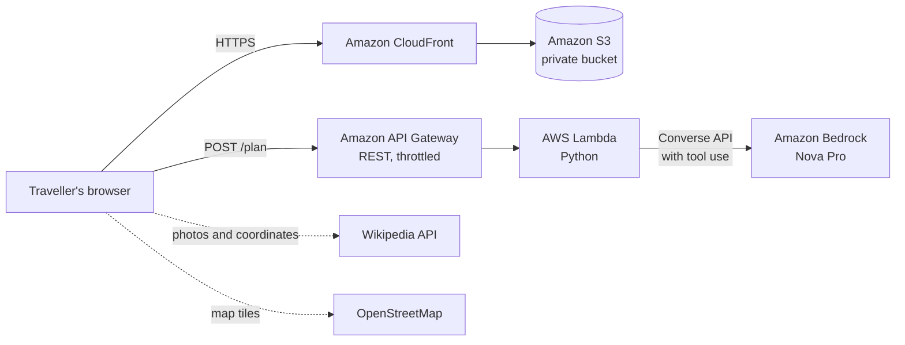

# Follow Your Soul

**An AI trip planner built on AWS.** Tell it where you want to go, when, and what you can spend, and it plans each day of the trip: places to see, somewhere to stay and local food to try, all within your budget.

**Live demo:** https://dc3jgqf88msxq.cloudfront.net

> Take me to **Manali** for **4** days in **December**, **1** traveller, with **₹15,000** to spend. I love **food, adventure**.

The result is a day-by-day plan with a budget breakdown, a map of each day's stops, photos, and local dishes such as siddu, trout and dham, plus warnings for places that are closed in that season.

## Architecture



| Layer | Service | What it does |
| --- | --- | --- |
| Website | Amazon S3 + CloudFront | Hosts the single-page site in a private bucket and serves it over HTTPS |
| API | Amazon API Gateway (REST) | `POST /plan` endpoint with CORS and stage throttling |
| Compute | AWS Lambda (Python, arm64) | Validates input, calls the planner, returns JSON |
| AI | Amazon Bedrock (Nova Pro) | Writes the itinerary through a forced tool call, so output is always structured JSON |
| Access | AWS IAM | Lambda role can invoke only the Nova Pro model |

## How the planner keeps plans within budget

Language models are poor at arithmetic. In early tests the model reported a total of ₹15,000 when its own line items added up to ₹21,000. So the planner splits the work:

1. **The AI chooses:** sights, dishes, a place to stay and its nightly price, and estimates for food, transport and activities.
2. **The code calculates:** nights, stay cost and the trip total.
3. **The code checks:** if the trip is over budget, the exact overspend is sent back to the model as a tool result ("₹4,000 over, cut at least ₹4,000"), and it revises the plan. Up to three attempts.

```
AI plans  →  code calculates and validates  →  over budget?  →  AI revises  →  valid plan
```

Output is forced into a JSON schema with Bedrock's tool use (`toolChoice`), so there is no fragile parsing of free text.

## Features

- Sentence-style trip form
- Budget donut chart with what's left to spare
- Map of each day's stops with a dotted route (Leaflet + OpenStreetMap)
- Destination and per-day photos from Wikipedia
- Swipeable day tabs, dark mode, and a phone-friendly layout
- Season-aware prompt that avoids places closed in that month
- Input validation in Lambda (budget ₹1,000 to ₹10,00,000, 1 to 10 days)

## Project structure

```
follow-your-soul/
├── backend/
│   ├── planner.py           # Bedrock call, JSON schema, budget validation and retry loop
│   └── lambda_function.py   # Lambda entry point: input checks and HTTP responses
└── frontend/
    └── index.html           # The whole website: HTML, CSS and JavaScript
```

## Run the planner locally

Requires Python 3.10+, the AWS CLI configured with access to Amazon Bedrock in `ap-south-1`.

```bash
cd backend
python3 -m venv .venv && source .venv/bin/activate
pip install boto3
python planner.py --destination Manali --budget 15000 --days 4 --month December --interests "food, adventure"
```

Set `FYS_MODEL_ID` to use a different Bedrock model or inference profile.

## What I learned

- **Put rules in code, not only in the prompt.** The prompt asks the model to skip places closed in winter and to keep a 10% buffer, and it sometimes ignores both. Checks in code are reliable; prompt rules are suggestions.
- **Pick the model by testing.** Nova Lite was cheaper but gave generic food and invented sights; Nova Pro gave valid plans in fewer attempts.
- **Free plan accounts need care.** Enabling IAM Identity Center creates an AWS Organization, which ends the Free plan, so this project uses an IAM user with MFA.

## Roadmap

- [x] Phase 1: AI planner, Lambda, API Gateway, website on S3 + CloudFront
- [ ] Enforce the budget buffer and catch repeated sights in code
- [ ] Real data: weather forecasts and Amazon Location Service for places and travel times
- [ ] Group trip mode: shared links and live voting over API Gateway WebSockets, Step Functions to finalize
- [ ] Security: AWS WAF rate limiting, Cognito login, Bedrock Guardrails, KMS
- [ ] Infrastructure as code with Terraform, CI/CD with GitHub Actions (OIDC)

---

Built by Jabez Samuel. Plans are AI-generated, so check opening times and prices before you book.
